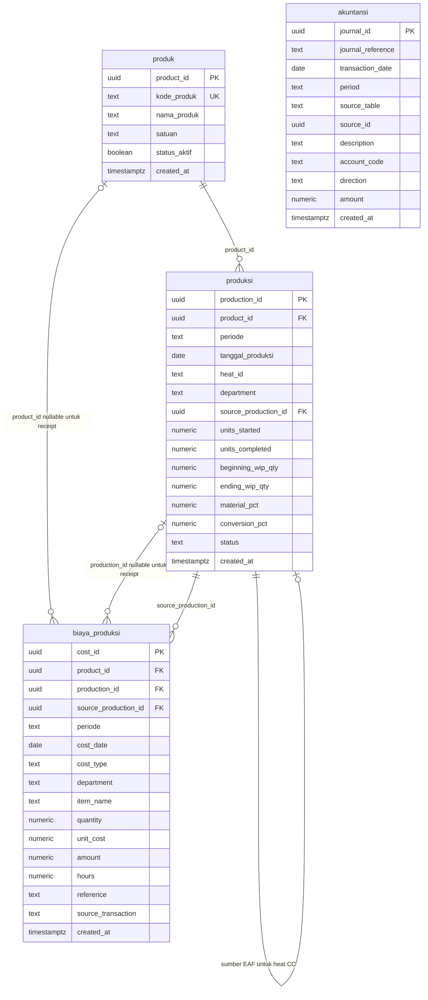

# Sistem Informasi Akuntansi Biaya Produksi PT HanaSteel

Aplikasi akademik untuk mencatat transaksi produksi dan biaya, menghitung biaya proses, serta menyajikan informasi persediaan dan jurnal pada simulasi perusahaan manufaktur baja dengan produk **Steel Billet**. Alur produksi yang direpresentasikan adalah **EAF / Steelmaking → Continuous Casting → Finished Goods**, menggunakan metode **Process Costing – Weighted Average**.

> Aplikasi ini merupakan prototipe akademik berbasis web statis, bukan klaim sebagai ERP industri yang lengkap.

## Demo Aplikasi

[Buka demo PT HanaSteel di GitHub Pages](https://yohanaharianjaaa.github.io/Process-Costing-System-/)

Ketersediaan aplikasi demo bergantung pada publikasi GitHub Pages dan konfigurasi Supabase yang aktif. Jangan memasukkan data rahasia atau data perusahaan nyata melalui demo.

## Identitas Tugas

| Keterangan | Identitas |
| --- | --- |
| Nama | Yohana Harianja |
| NIM | 12030124140228 |
| Mata Kuliah | Pemrograman / Coding |
| Kelas | D |
| Dosen Pengampu | Totok Dewayanto |

## Tentang Sistem

Sistem membantu pengguna merekam data produk, heat produksi, dan biaya proses, kemudian mengolah data tersebut menjadi informasi biaya menurut produk, periode, dan departemen. Biaya dikumpulkan pada EAF / Steelmaking dan dilanjutkan sebagai biaya transfer-in pada Continuous Casting. Hasil proses digunakan untuk menampilkan Equivalent Units, Cost per Equivalent Unit, biaya output selesai, Ending WIP, Finished Goods, COGM, persediaan, Cost Reconciliation, dan jurnal berpasangan.

Kuantitas produksi dicatat sebagai angka dengan presisi desimal; persentase penyelesaian digunakan untuk menghitung equivalent units serta bagian biaya WIP. Nilai rupiah berasal dari input biaya dan perhitungan aplikasi. Pengguna perlu menjaga satuan kuantitas agar konsisten ketika memasukkan data: aplikasi tidak melakukan konversi otomatis antarsatuan.

## Tujuan dan Manfaat

- Mendokumentasikan aliran informasi biaya pada dua departemen produksi.
- Menautkan pencatatan biaya proses ke produk, periode, dan heat terkait.
- Menunjukkan pembebanan biaya ke output selesai dan persediaan dalam proses.
- Menyediakan informasi pendukung analisis biaya produksi dan persediaan.
- Menampilkan jurnal Debit/Kredit yang berasal dari transaksi dan alokasi yang didukung aplikasi.
- Membantu demonstrasi konsep akuntansi biaya dan Process Costing – Weighted Average.

## Fitur Utama

Navigasi aplikasi saat ini terdiri atas:

| Menu | Fungsi yang tersedia |
| --- | --- |
| **Dashboard** | Ringkasan periode berjalan, biaya proses, COGM, kuantitas output, Finished Goods, Ending WIP, serta aktivitas departemen dan heat terbaru. Total Biaya Proses adalah agregasi `totalToAccount` antardepartemen, termasuk biaya transfer-in yang diperhitungkan kembali di CC; angka ini bukan COGM dan bukan ukuran biaya eksternal terkonsolidasi. |
| **Master Data** | Daftar Produk, Bahan Baku, dan Departemen Produksi. Produk disimpan di `produk`; daftar bahan diturunkan dari nama item transaksi biaya; departemen merupakan daftar terkendali di aplikasi. |
| **Produksi** | Pencatatan Batch/Heat, pemantauan WIP dan perpindahan antar-departemen. Heat CC ditautkan ke heat EAF sumber. |
| **Biaya Produksi** | Pencatatan material (receipt dan usage), tenaga kerja langsung, overhead manufaktur, serta saldo biaya Beginning WIP. |
| **Process Costing** | Tampilan Equivalent Units, Cost per Equivalent Unit, dan Production Cost Report berdasarkan kalkulasi Weighted Average di frontend. |
| **Akuntansi** | Jurnal Debit/Kredit berpasangan dan Chart of Accounts. Daftar akun dikendalikan oleh kode aplikasi serta constraint database, bukan tabel COA tersendiri. |
| **Laporan** | Laporan Biaya Produksi, Laporan WIP, Laporan Persediaan, Persediaan Barang Jadi, COGM, dan Cost Reconciliation. |
| **Pengaturan** | Pengelolaan periode, identitas operator aktif di browser, dan tampilan metode costing yang digunakan. |

### Fungsi Laporan

- **Laporan Biaya Produksi** merangkum biaya yang diperhitungkan dan alokasinya menurut produk serta departemen.
- **Laporan WIP** menampilkan produk yang masih memiliki Ending WIP beserta kuantitas dan nilai biaya yang belum selesai.
- **Persediaan Barang Jadi** mengakumulasi output selesai CC dan nilai costing per produk sampai periode yang dipilih. Tidak ada transaksi barang jadi keluar yang diasumsikan.
- **COGM (Cost of Goods Manufactured)** menampilkan biaya output selesai pada Continuous Casting untuk periode yang dipilih.
- **Cost Reconciliation** membandingkan biaya yang diperhitungkan dengan biaya output selesai dan Ending WIP; selisih dihitung dari hasil alokasi dan diharapkan balance, dengan kemungkinan pembulatan.
- **Laporan Persediaan** menyatukan nilai raw material, WIP periode yang dipilih, dan Finished Goods kumulatif sampai periode tersebut. Laporan ini bukan tabel inventory terpisah.

## Alur Kerja Sistem

1. **Tentukan produk** yang akan diproduksi pada menu Master Data. Produk memiliki kode, nama, satuan, dan status aktif.
2. **Catat penerimaan bahan baku** sebagai `MATERIAL_RECEIPT`. Receipt tidak ditautkan ke heat tertentu; kuantitas dan biaya satuannya menjadi dasar saldo material.
3. **Catat heat EAF / Steelmaking**, termasuk produk, tanggal, kuantitas mulai/selesai, Beginning WIP, Ending WIP, dan persentase penyelesaian.
4. **Catat biaya proses EAF** yang relevan: pemakaian bahan (`MATERIAL_USAGE`), tenaga kerja (`DIRECT_LABOR`), overhead (`MANUFACTURING_OVERHEAD`), dan komponen Beginning WIP jika ada.
5. **Catat heat Continuous Casting** dengan memilih heat EAF sumber. Validasi mensyaratkan produk dan periode sama, serta `units_started` CC sama dengan `units_completed` heat EAF sumber.
6. **Catat biaya CC** dan saldo Beginning WIP yang relevan pada heat CC. Biaya proses ditautkan ke `production_id` dan harus konsisten dengan produk, periode, serta departemennya.
7. **Tinjau hasil Process Costing** untuk melihat equivalent units, tarif biaya per EU, biaya transferred-out, nilai Ending WIP, dan selisih rekonsiliasi.
8. **Tinjau laporan dan jurnal**. Aplikasi menghitung inventory dari transaksi/hasil costing dan menyinkronkan jurnal otomatis untuk transaksi yang didukung.

Physical flow produksi yang divalidasi adalah:

```text
Beginning WIP + Units Started = Units Completed + Ending WIP
```

Untuk Continuous Casting, kuantitas yang dimulai juga harus sama dengan output selesai heat EAF yang ditautkan. Validasi aplikasi dan trigger database memeriksa hubungan ini.

## Logika Akuntansi dan Perhitungan Biaya

### Jenis Biaya

| Jenis | Fungsi dalam aplikasi |
| --- | --- |
| `MATERIAL_RECEIPT` | Mencatat penerimaan bahan baku; jumlah material menambah saldo raw material. |
| `MATERIAL_USAGE` | Mencatat bahan yang digunakan heat; nilai material dihitung dari kuantitas × biaya satuan dan menjadi biaya material proses. |
| `DIRECT_LABOR` | Mencatat biaya tenaga kerja langsung sebagai biaya konversi departemen/heat. |
| `MANUFACTURING_OVERHEAD` | Mencatat overhead manufaktur sebagai biaya konversi departemen/heat. |
| `BEGINNING_WIP_MATERIAL` | Komponen material pada biaya awal WIP. |
| `BEGINNING_WIP_CONVERSION` | Komponen konversi pada biaya awal WIP. |
| `BEGINNING_WIP_TRANSFERRED_IN` | Komponen biaya transfer awal yang dibatasi untuk Continuous Casting. |
| `TRANSFER_IN`, `FINISHED_GOODS_COST` | Nilai hasil perhitungan sistem, bukan jenis biaya yang boleh dimasukkan sebagai transaksi manual melalui aplikasi. |

### Process Costing – Weighted Average

Frontend mengelompokkan produksi dan biaya menurut **produk, departemen, dan periode**. Untuk setiap kelompok, perhitungan yang diterapkan adalah:

```text
Material EU
  = Units Completed + (Ending WIP × persentase penyelesaian material)

Conversion EU
  = Units Completed + (Ending WIP × persentase penyelesaian konversi)

Transfer EU
  = Units Completed + Ending WIP
```

Persentase pada rumus digunakan sebagai proporsi, yaitu nilai persen dibagi 100.

```text
Material Rate / EU
  = (Beginning WIP Material + Material Usage periode) / Material EU

Conversion Rate / EU
  = (Beginning WIP Conversion + Direct Labor + Manufacturing Overhead)
    / Conversion EU

Transfer-in Rate / EU pada CC
  = (Beginning WIP Transferred-in + Transfer-in periode) / Transfer EU

Total Cost / EU
  = Material Rate / EU + Conversion Rate / EU + Transfer-in Rate / EU

Completed / Transferred-out Cost
  = Units Completed × Total Cost / EU
```

Jika penyebut EU bernilai nol, implementasi menetapkan rate komponen tersebut menjadi nol. Beginning WIP dan biaya periode berjalan digabung dalam perhitungan Weighted Average. Beginning WIP dicatat sebagai komponen biaya `biaya_produksi` yang terhubung ke heat.

Ending WIP dihitung dari bagian biaya transfer-in (untuk proses CC), material, dan konversi sesuai kuantitas Ending WIP serta persentase penyelesaian material/konversi. Selanjutnya:

```text
Costs to Account For
  = Beginning WIP Material
  + Beginning WIP Conversion
  + Beginning WIP Transferred-in
  + Material Usage periode
  + Direct Labor dan Manufacturing Overhead periode
  + Transfer-in periode (bila departemen CC)

Reconciliation Difference
  = Costs to Account For
  − Completed / Transferred-out Cost
  − Ending WIP Cost
```

Biaya `MATERIAL_USAGE` pada proses costing diambil dari nilai transaksi biaya; validasi database mensyaratkan amount material sesuai kuantitas × biaya satuan dalam toleransi pembulatan.

### Transfer Antardepartemen, Finished Goods, dan COGM

Biaya per unit EAF diteruskan ke CC berdasarkan kuantitas yang dimulai pada heat CC yang terhubung ke sumber EAF. Nilai transfer tersebut **memindahkan** biaya WIP EAF menjadi WIP CC. Ia merupakan biaya transferred-in dalam proses penerima, bukan biaya baru dari transaksi pembelian/biaya eksternal.

Saat output CC selesai, aplikasi mengalokasikan biaya completed dari WIP CC ke Finished Goods. Alokasi Finished Goods juga **bukan biaya baru yang kembali ditambahkan**. Nilai COGM pada laporan berasal dari completed/transferred-out cost departemen CC. Dengan demikian:

- **Total Biaya Proses** di Dashboard menjumlahkan `totalToAccount` hasil costing tiap departemen; komponen transfer-in CC ikut dihitung pada total proses.
- **COGM** menunjukkan biaya output selesai CC untuk periode yang dipilih.
- Kedua angka memiliki cakupan berbeda dan tidak boleh ditafsirkan sebagai angka yang sama.

Inventory raw material dihitung dari penerimaan dikurangi pemakaian berdasarkan `item_name`. Laporan persediaan barang jadi mengakumulasi output selesai pada periode-periode sampai periode pilihan; sistem tidak mengasumsikan outbound atau penjualan Finished Goods. Ending WIP merupakan saldo perhitungan dan tidak membentuk jurnal tambahan tersendiri.

### Pembentukan Jurnal Otomatis

Jurnal disimpan sebagai baris aktual di `akuntansi`. Untuk jenis transaksi yang didukung, pasangan akun yang dibentuk frontend adalah:

| Transaksi | Debit | Kredit |
| --- | --- | --- |
| Penerimaan bahan baku | `RAW_MATERIAL_INV` | `ACCOUNTS_PAYABLE` |
| Pemakaian bahan baku | `WIP_EAF` atau `WIP_CC` | `RAW_MATERIAL_INV` |
| Tenaga kerja langsung | `WIP_EAF` atau `WIP_CC` | `WAGES_PAYABLE` |
| Manufacturing overhead | `WIP_EAF` atau `WIP_CC` | `OVERHEAD_CLEARING` |
| Transfer biaya EAF ke CC | `WIP_CC` | `WIP_EAF` |
| Output CC selesai ke Finished Goods | `FINISHED_GOODS_INV` | `WIP_CC` |

Nominal jurnal berasal dari transaksi aktual atau alokasi biaya hasil proses. Tabel `akuntansi` menyimpan `journal_reference`, tanggal/periode, keterangan, kode akun, arah, nominal, serta identifikasi sumber (`source_table` dan `source_id`). Constraint dan trigger skema memeriksa sumber transaksi dan keseimbangan debit/kredit per reference.

Pada periode aktif yang berstatus OPEN, pemuatan aplikasi dapat menjalankan sinkronisasi jurnal otomatis. Periksa periode dan data yang digunakan sebelum demonstrasi; hindari menguji pada database bersama atau database berisi data penting tanpa backup dan pemahaman terhadap dampaknya.

## ERD

ERD berikut hanya menggambarkan empat entity database utama. `source_table` dan `source_id` pada `akuntansi` merupakan referensi polimorfik yang diperiksa oleh trigger; keduanya **bukan foreign key langsung** ke dua tabel sumber.



Relasi langsung yang didefinisikan di skema meliputi `produksi.product_id → produk.product_id`, referensi `produksi` dan `produk` pada `biaya_produksi`, referensi rekursif `produksi.source_production_id → produksi.production_id`, serta `biaya_produksi.source_production_id → produksi.production_id`. `product_id` dan `production_id` pada biaya nullable untuk receipt; constraint mewajibkan keduanya untuk jenis biaya selain receipt. Referensi sumber jurnal diperiksa menggunakan trigger karena `source_id` dapat menunjuk ke salah satu dari dua tabel sumber.

**Tidak ada tabel tersendiri** untuk departemen, periode, Chart of Accounts, inventory, WIP valuation, COGM, atau laporan. Daftar/identitas tertentu dikendalikan di frontend; saldo dan laporan dihitung dari empat entity utama. ERD ini menggunakan Mermaid; visualisasinya bergantung pada dukungan renderer Markdown yang digunakan.

## Struktur Folder dan File

```text
Process Costing System HanaSteel/
├── README.md
├── index.html
├── .gitignore
├── Laporan Dokumentasi_Sistem_Process_Costing_PT_HanaSteel.docx
├── backend/
│   ├── app.js
│   └── schema.sql
└── frontend/
    ├── index.html
    ├── app.js
    └── styles.css
```

| File | Fungsi |
| --- | --- |
| `index.html` (root) | Pengarah sederhana ke `frontend/`. |
| `README.md` | Dokumentasi proyek, konfigurasi, alur, dan batasan. |
| `.gitignore` | Aturan file yang diabaikan Git. |
| `backend/app.js` | Konfigurasi browser untuk URL proyek Supabase, publishable key, environment, dan periode awal. Berkas ini bukan server backend. |
| `backend/schema.sql` | Definisi/migrasi skema PostgreSQL, fungsi dan trigger validasi, kebijakan demo, serta cleanup tabel legacy. Baca peringatan database sebelum digunakan. |
| `frontend/index.html` | Shell HTML, header, sidebar, form modal, font eksternal, dan pemanggilan berkas aplikasi. |
| `frontend/app.js` | UI, REST API client, pemetaan nama kolom database, validasi input, perhitungan costing, laporan, dan sinkronisasi jurnal. |
| `frontend/styles.css` | Gaya visual dan layout responsif aplikasi. |
| `Laporan Dokumentasi_Sistem_Process_Costing_PT_HanaSteel.docx` | Dokumen Word tambahan yang tersedia di root proyek. |

Tidak ada `package.json`, framework frontend, atau proses build khusus yang diperlukan oleh file proyek yang terdaftar.

## Teknologi

- **HTML5** untuk struktur halaman aplikasi.
- **CSS** untuk tampilan, typography, dan layout responsif.
- **JavaScript browser tanpa framework** untuk navigasi, formulir, validasi antarmuka, rendering, dan perhitungan.
- **Supabase PostgreSQL** sebagai penyimpanan data.
- **Supabase REST API / PostgREST**: frontend mengirim permintaan langsung ke endpoint `/rest/v1/<nama_entity>` menggunakan `fetch`, publishable key pada header `apikey`, serta payload/response JSON. Operasi data yang digunakan meliputi baca, tambah, ubah, dan hapus.
- **VS Code Live Server atau static hosting** untuk menyajikan file frontend. Google Fonts DM Sans dan Manrope dimuat dari layanan eksternal saat tersedia.

Tidak ada server aplikasi perantara yang menjalankan perhitungan costing di backend; perhitungan utama dilakukan pada JavaScript frontend berdasarkan data yang diambil dari empat entity.

## Konfigurasi dan Menjalankan Aplikasi

### Prasyarat

- Browser modern dengan JavaScript aktif.
- Proyek Supabase yang dikonfigurasi untuk empat entity aplikasi.
- Editor teks atau VS Code untuk mengatur `backend/app.js`.
- Server statis lokal, misalnya ekstensi VS Code Live Server, atau hosting statis.

### Menyiapkan Konfigurasi Supabase

1. Buat atau pilih proyek Supabase yang memang disiapkan untuk aplikasi ini.
2. Buka `backend/app.js` dan atur `projectUrl`, `publishableKey`, `environment`, serta `periodControl` sesuai kebutuhan lingkungan yang digunakan.
3. Gunakan **publishable key** yang memang dirancang untuk dipakai oleh aplikasi browser. Jangan pernah menaruh `service_role` key, secret key, kredensial database, atau token administratif pada file frontend, README, repositori publik, maupun browser.
4. Pastikan empat tabel beserta kolom dan constraint yang diharapkan aplikasi tersedia. Aplikasi menerjemahkan sejumlah nama kolom di frontend, tetapi tetap mengandalkan bentuk data dan constraint yang sesuai skema proyek.
5. Kebijakan akses Supabase harus dipilih secara sadar dan disesuaikan dengan apakah instalasi hanya untuk demonstrasi atau penggunaan yang lebih luas. Lihat bagian Keamanan.

### Peringatan Wajib untuk `backend/schema.sql`

`backend/schema.sql` bukan sekadar skrip pembuat tabel kosong. Selain membuat/mengubah kolom, fungsi, trigger, RLS, dan policy, skrip memuat pemeriksaan cleanup serta `DROP TABLE IF EXISTS ... RESTRICT` untuk nama-nama tabel legacy, termasuk `journal_lines`, `production_batches`, `wip_balances`, `materials`, `products`, `chart_of_accounts`, `accounting_periods`, dan lainnya. Skrip berakhir dengan pemeriksaan bahwa tepat empat entity utama yang tersisa.

- **Database baru dan kosong:** tinjau seluruh isi skrip, pastikan proyek Supabase benar-benar baru dan tidak menyimpan data yang perlu dipertahankan, lalu jalankan hanya pada proyek terisolasi yang memang dimaksudkan untuk instalasi ini. Pastikan kebijakan demo di dalam skrip sesuai kebutuhan sebelum menerapkannya.
- **Database yang sudah digunakan atau berisi data:** jangan jalankan ulang `schema.sql`. Skrip dapat menghapus tabel legacy yang namanya cocok dan mengubah skema/akses. Buat backup terlebih dahulu dan minta peninjauan/migrasi terkontrol dari pengelola database sebelum melakukan perubahan.
- **Jika ragu:** jangan menjalankan skrip. Konfirmasi isi database dan dampak migrasi dengan pengelola proyek.

Dokumentasi ini tidak menjalankan SQL, migrasi, maupun perubahan apa pun pada Supabase.

### Membuka Secara Lokal

1. Buka folder proyek di VS Code.
2. Jalankan Live Server pada `frontend/index.html`, atau sajikan folder proyek menggunakan server statis yang tersedia.
3. Alternatifnya, sajikan root proyek: `index.html` mengarahkan browser ke `./frontend/`.
4. Pastikan URL dan publishable key di `backend/app.js` mengarah ke proyek Supabase yang telah disiapkan.
5. Buka alamat lokal yang diberikan server statis dan periksa apakah data dapat dimuat.

Jangan mengandalkan membuka berkas melalui `file://` sebagai cara demonstrasi utama; penggunaan server statis lebih sesuai untuk pemuatan modul dan permintaan jaringan browser.

### Mengakses Demo GitHub Pages

Gunakan tautan [demo GitHub Pages](https://yohanaharianjaaa.github.io/Process-Costing-System-/). Hosting statis hanya menyajikan berkas frontend; penyimpanan data dan akses REST tetap bergantung pada Supabase yang dikonfigurasi dalam kode. Ketersediaan demo, koneksi, dan kondisi database mengikuti konfigurasi/publikasi aktual dan tidak dijamin oleh hosting statis itu sendiri.

## Catatan Keamanan, Batasan, dan Demonstrasi

### Keamanan dan Akses Database

- Tidak ditemukan implementasi autentikasi pengguna pada aplikasi. Nama/role operator yang tampil adalah konteks UI, bukan akun login atau otorisasi.
- `backend/schema.sql` mengaktifkan Row Level Security pada empat tabel, tetapi membuat policy `hanasteel_demo_access` untuk role `anon` dengan operasi `FOR ALL`, `USING (true)`, dan `WITH CHECK (true)` apabila policy tersebut belum ada. Skema juga memberikan hak `SELECT`, `INSERT`, `UPDATE`, dan `DELETE` kepada `anon`.
- Karena kebijakan tersebut, publishable key yang tertanam di browser **bukan** perlindungan akses data. Siapa pun yang dapat mengakses konfigurasi aplikasi dapat mencoba berinteraksi langsung dengan REST API. RLS yang aktif tidak berarti data terlindungi jika policy mengizinkan seluruh akses anon.
- Validasi periode, operator, dan sebagian aturan input pada JavaScript adalah validasi antarmuka, bukan batas keamanan server. Periode/operator disimpan di `localStorage` browser dan tidak tersinkron antarpengguna/perangkat.
- Jangan gunakan konfigurasi policy demo atau kredensial proyek demonstrasi untuk data rahasia/operasional. Penggunaan perusahaan memerlukan autentikasi, otorisasi dan policy server-side yang dirancang serta diuji secara terpisah.
- Publishable key dapat terekspos di aplikasi browser; **service-role key dan secret key tidak boleh** ditempatkan pada browser. Jika kredensial sensitif pernah terpublikasi, lakukan rotasi melalui pengelola Supabase.

### Batasan Implementasi

- Aplikasi adalah prototipe akademik untuk alur biaya produksi yang didefinisikan, bukan ERP/manufaktur lengkap atau pengganti kontrol akuntansi perusahaan.
- Hanya empat entity inti yang menyimpan data bisnis. Daftar departemen dan akun dikendalikan pada aplikasi; inventory, WIP valuasi, COGM, dan laporan dihitung, bukan disimpan sebagai tabel khusus.
- Perhitungan costing dan sinkronisasi jurnal berjalan di frontend. Data dan logika browser dapat diperiksa serta dimodifikasi oleh pengguna; jangan memperlakukannya sebagai batas kontrol internal produksi.
- Biaya otomatisasi jurnal saat ini mencakup material receipt/usage, direct labor, manufacturing overhead, transfer EAF–CC, dan alokasi output selesai sesuai kondisi yang tercantum di kode. Jenis Beginning WIP mempengaruhi costing, tetapi bukan jurnal biaya otomatis tersendiri pada logika frontend saat ini.
- Sistem tidak mengasumsikan transaksi outbound Finished Goods, penjualan, retur, maupun rekonsiliasi persediaan fisik.
- Unit produksi diolah sebagai angka. Tidak ada konversi otomatis antarsatuan produk.
- Periode dan operator berada di penyimpanan browser; data konteks ini tidak menjadi tabel Supabase dan tidak dibagikan otomatis.
- Konfigurasi periode di `backend/app.js` menyediakan periode awal untuk browser, namun keadaan lokal yang sudah tersimpan dapat mempengaruhi periode/operator saat dibuka.
- Font antarmuka dimuat dari Google Fonts; tampilan akan menggunakan fallback jika layanan eksternal tidak tersedia.

### Saran Saat Demonstrasi

1. Pastikan demo menggunakan proyek/database yang memang disediakan untuk praktik dan data yang boleh ditampilkan.
2. Jangan jalankan ulang `backend/schema.sql` pada database yang sudah berisi data.
3. Mulai dari produk dan penerimaan bahan, lalu catat heat EAF, biaya terkait, heat CC yang menunjuk heat sumber, dan biaya CC.
4. Pastikan periode aktif terbuka dan tanggal transaksi sesuai periode.
5. Jaga konsistensi satuan dan masukkan kuantitas, persentase penyelesaian, serta nominal sesuai data demonstrasi.
6. Periksa physical flow, validasi hubungan sumber EAF–CC, Equivalent Units, Cost per Equivalent Unit, WIP, Finished Goods, COGM, dan Cost Reconciliation.
7. Tinjau pasangan Debit/Kredit jurnal serta status balance. Pada periode OPEN, pemuatan aplikasi dapat menyinkronkan jurnal ke database.
8. Hindari menghapus atau mengubah transaksi yang sudah direferensikan jurnal tanpa memahami relasi dan dampak alokasi.
9. Jangan tampilkan konfigurasi Supabase atau data sensitif pada rekaman/screenshot presentasi.

## Verifikasi Informasi Proyek

Tautan demo, identitas tugas, dan dosen pengampu pada README ini mengikuti informasi yang diberikan untuk dokumentasi proyek. Ketersediaan demo GitHub Pages serta isi dokumen Word tambahan sebaiknya diperiksa kembali secara manual sebelum presentasi atau publikasi.
